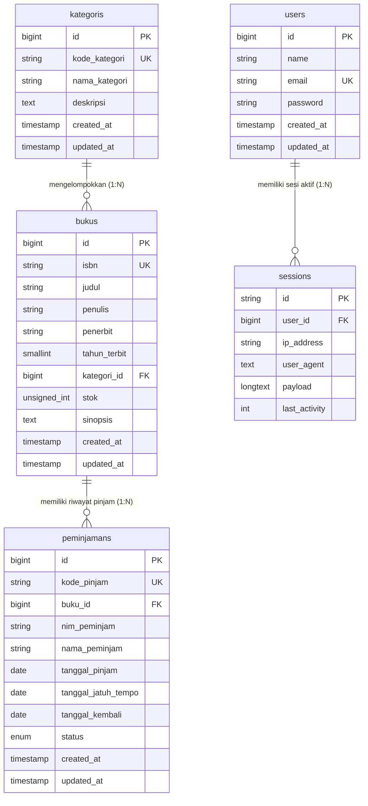

# SIPUS-Del — Sistem Informasi Perpustakaan Kampus Del (Tahap 2)

Praktikum Pemrograman & Pengujian Web (12S3101) &bull; Institut Teknologi Del  
**Modul Minggu 06**: Konektivitas Basis Data Persisten (MySQL Laragon), Arsitektur PDO & Parameter Binding, Transaksi Basis Data ACID (`DB::transaction` & `lockForUpdate`), Fluent Query Builder (`DB::table`), Agregasi Relasi `withCount`, serta Manajemen Sesi & Autentikasi Pustakawan pada Laravel 11.x.

---

## 🏛️ Fitur Utama Minggu 06 (SIPUS-Del Tahap 2)

1. **Konektivitas Basis Data Persisten MySQL (Laragon)**:
   - Menggunakan mesin basis data **MySQL 8.0 (InnoDB)** dengan dukungan penuh transaksi ACID, *foreign key constraints*, dan *row-level locking*.
   - Abstraksi PDO dengan prepared statements untuk pencegahan mutlak SQL Injection.

2. **Transaksi Sirkulasi Berbasis ACID & Pessimistic Locking (`lockForUpdate`)**:
   - **Peminjaman Buku Atomik**: Seluruh proses validasi, pemeriksaan sisa stok, verifikasi peminjaman ganda untuk NIM yang sama, pengurangan kuota stok (`$buku->decrement('stok')`), dan pencatatan riwayat sirkulasi dibungkus dalam `DB::transaction()` dengan proteksi kueri `SELECT ... FOR UPDATE` (`lockForUpdate()`) guna mengeliminasi risiko *race condition*.
   - **Rollback Otomatis Saat Stok Habis**: Jika sisa stok = 0, sistem secara instan menggagalkan transaksi dan membatalkan mutasi data (stok tidak pernah bernilai minus).
   - **Pengembalian Buku Atomik**: Mengembalikan stok buku (`$buku->increment('stok')`), mengisi tanggal kembali, dan mengubah status menjadi `'dikembalikan'`.
   - **Audit Keamanan Error**: Menangkap `QueryException` dan mencatat jejak stack ke berkas log via `Log::error()`.

3. **Fluent Query Builder (`DB::table`) & Optimasi Agregasi `withCount`**:
   - **Statistik Cepat**: Rekapitulasi metrik perpustakaan (Total Judul, Total Eksemplar Fisik `sum('stok')`, Sedang Dipinjam, dan Selesai Dikembalikan) dihitung efisien menggunakan Fluent Query Builder `DB::table()`.
   - **Eliminasi Masalah $N+1$**: Katalog buku memuat relasi kategori via Eager Loading dan menghitung frekuensi sirkulasi menggunakan `withCount('peminjamans')` dalam 1 kueri agregasi optimal.
   - **Filter Dinamis `when()` & Paginasi Presisten**: Pencarian multi-kriteria (judul, penulis, ISBN, kategori) dengan mempertahankan string kueri peramban melalui `withQueryString()`.

4. **Manajemen Sesi Pengguna & Autentikasi Pustakawan**:
   - **Sistem Login & Logout**: Dibangun pada `AuthController` menggunakan `Auth::attempt()`.
   - **Mitigasi Session Fixation**: Wajib memanggil `$request->session()->regenerate()` setiap kali pustakawan berhasil masuk.
   - **Penerbitan HTTP Cookie Aman**: Terbitan cookie `del_last_librarian_email` via `Cookie::queue()` dengan atribut bawaan Laravel `HttpOnly=true` dan `SameSite=Lax`.
   - **Proteksi Rute Transaksional**: Seluruh aksi mutasi data (tambah/edit/hapus buku, kategori, serta seluruh aksi peminjaman dan pengembalian) diproteksi ketat menggunakan middleware `auth`.

---

## 📊 Entity Relationship Diagram (ERD)



---

## 🔑 Kredensial Akun Pustakawan Uji (Sesuai Modul)

| Parameter | Nilai Akun Uji |
|---|---|
| **URL Portal Login** | `http://localhost:8000/login` |
| **Email Pustakawan** | `pustakawan@del.ac.id` |
| **Kata Sandi (Password)** | `password123` |
| **Role / Wewenang** | Pustakawan Utama IT Del (Hak Penuh Sirkulasi & Kurasi Buku) |

---

## 🚀 Panduan Menjalankan Aplikasi dengan Laragon

### 1. Prasyarat Lingkungan
- **Laragon Full / Lite** (Apache + MySQL aktif)
- **PHP** >= 8.2 (dengan ekstensi `pdo_mysql`, `mbstring`, `openssl`, `intl` aktif)
- **Composer** & **Node.js**

### 2. Konfigurasi Basis Data
1. Buka **Laragon**, klik **Start All**.
2. Buka **HeidiSQL** (tombol *Database* di Laragon) dan buat database baru bernama `sipus_del`.
3. Pastikan konfigurasi `.env` pada folder `sim-del/` terisi:
   ```env
   DB_CONNECTION=mysql
   DB_HOST=127.0.0.1
   DB_PORT=3306
   DB_DATABASE=sipus_del
   DB_USERNAME=root
   DB_PASSWORD=
   ```

### 3. Migrasi & Seeding Data Uji Lengkap
Jalankan perintah berikut di direktori `sim-del/`:
```powershell
cd sim-del
php artisan migrate:fresh --seed
```
*Perintah ini akan secara otomatis menyiapkan tabel, akun pustakawan resmi, kategori, serta spesimen buku khusus untuk pengujian stok 0 dan stok 1.*

### 4. Menjalankan Server Lokal
```powershell
# Jalankan backend Laravel
php artisan serve
```
Akses web pada peramban: **[http://localhost:8000](http://localhost:8000)**.

---

## 🧪 Bukti Pengujian Otomatis (Automated Feature Tests)

Seluruh logika bisnis kritis Week 6 telah diverifikasi menggunakan pengujian terotomasi Pest/PHPUnit:

```powershell
php artisan test
```

### Hasil Eksekusi Pengujian:
```text
   PASS  Tests\Unit\ExampleTest
  ✓ that true is true

   PASS  Tests\Feature\AcidTransactionTest
  ✓ peminjaman buku berhasil dan stok berkurang secara atomik
  ✓ peminjaman saat stok habis wajib ditolak dan rollback
  ✓ nim yang sama tidak bisa meminjam buku yang sama dua kali
  ✓ pengembalian buku mengembalikan stok secara atomik

   PASS  Tests\Feature\AuthSessionTest
  ✓ login pustakawan berhasil meregenerasi sesi dan cookie
  ✓ tamu tidak bisa mengakses rute sirkulasi dan dialihkan ke login
  ✓ logout pustakawan menghapus sesi

   PASS  Tests\Feature\ExampleTest
  ✓ the application returns a successful response

   PASS  Tests\Feature\QueryBuilderAnalyticsTest
  ✓ katalog buku memuat statistik query builder dan with count

  Tests:    10 passed (51 assertions)
  Duration: 0.78s
```

---

## 📸 Bukti Pengujian Transaksi ACID & Audit Cookie DevTools

### 1. Bukti Peminjaman & Pengembalian Sukses (Mutasi Stok Atomik)
- **Skenario**: Pustakawan memilih buku berkategori tersedia (misal stok = 5), memasukkan NIM `12S24003` dan nama mahasiswa.
- **Hasil**: Kode transaksi `PJM-YYYYMMDD-XXXXXX` diterbitkan, stok buku di rak berkurang menjadi 4 secara atomik. Saat tombol "Kembalikan" ditekan, status berubah menjadi `dikembalikan` dan stok kembali menjadi 5.

*(Sematkan tangkapan layar antarmuka sirkulasi sukses di sini)*

---

### 2. Bukti Penolakan Transaksi Saat Stok Habis (Rollback ACID)
- **Skenario**: Mencoba meminjam buku uji khusus stok 0 (*Tata Kelola Teknologi Informasi & Framework COBIT 2019*).
- **Hasil**: Sistem melempar exception bisnis, database membatalkan transaksi (`rollback`), stok buku tetap 0 (tidak minus), dan muncul pesan kesalahan pop-up:
  > *"Stok buku 'Tata Kelola Teknologi Informasi & Framework COBIT 2019 (Stok = 0)' habis (stok = 0). Transaksi peminjaman ditolak."*

*(Sematkan tangkapan layar notifikasi penolakan stok 0 di sini)*

---

### 3. Bukti Audit Cookie `HttpOnly` pada Browser DevTools
- **Skenario**: Pustakawan berhasil login, lalu membuka Browser Developer Tools (`F12`) $\rightarrow$ tab **Application** (Chrome/Edge) $\rightarrow$ panel **Storage** $\rightarrow$ **Cookies** $\rightarrow$ `http://localhost:8000`.
- **Hasil Audit**:
  - Cookie `laravel_session`: Memiliki tanda centang (✔) pada kolom **HttpOnly** dan **SameSite=Lax**, mencegah pembacaan melalui skrip berbahaya XSS.
  - Cookie `del_last_librarian_email`: Diterbitkan dengan masa berlaku 7 hari dan terlindungi atribut `HttpOnly`.

*(Sematkan tangkapan layar DevTools Application > Cookies di sini)*

---

## 📦 Konvensi Commit Git Minggu 06

Sesuai dengan instruksi resmi Modul Praktikum Minggu 06:
1. `feat(migration): create peminjamans table with foreign key to bukus`
2. `feat(transaction): implement ACID book borrowing and return with lockForUpdate`
3. `feat(query-builder): add library analytics dashboard and dynamic search`
4. `feat(auth-session): implement librarian login, session regeneration, and cookies`
5. `docs(readme): add week 6 ERD, test evidence, and audit documentation`
