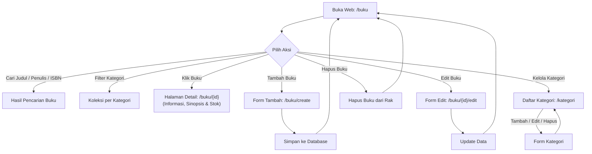

# SIPUS-Del — Sistem Informasi Perpustakaan Kampus Del

Aplikasi web manajemen dan katalog buku perpustakaan Institut Teknologi Del berbasis **Laravel 11 (MVC)**, database **SQLite**, dan aset frontend berbasis **Vite**.

---

## 🔄 Web-Flow

Diagram alur navigasi dan interaksi pengguna di aplikasi:



---

## ⚡ Cara Install & Setup Cepat

### 1. Prasyarat
- **PHP** >= 8.2 (dengan ekstensi `pdo_sqlite` aktif)
- **Composer**
- **Node.js** (v18+) & **npm**

---

### 2. Langkah Instalasi

Buka terminal dan masuk ke folder `sim-del`:
```bash
cd sim-del
```

#### A. Siapkan Konfigurasi `.env`
Salin template konfigurasi:
```bash
# Windows (PowerShell)
copy .env.example .env

# Linux / Mac / Git Bash
cp .env.example .env
```
*(Secara default database sudah diset menggunakan SQLite: `DB_CONNECTION=sqlite`)*.

#### B. Install Dependensi (Backend & Frontend)
Jalankan kedua perintah berikut:

```bash
# 1. Install dependensi PHP / Laravel
composer install

# 2. Install dependensi JavaScript / Vite (Frontend)
npm install
```

#### C. Generate App Key & Database
```bash
# Buat application key
php artisan key:generate

# Pastikan file database SQLite ada (jika belum ada)
# Windows:
type nul > database/database.sqlite
# Linux / Mac:
touch database/database.sqlite

# Migrasi tabel dan isi data dummy (Faker)
php artisan migrate:fresh --seed
```

---

## 🚀 Cara Menjalankan Aplikasi

Jalankan aplikasi dengan **2 terminal**:

### Terminal 1 — Backend (Laravel)
```bash
php artisan serve
```
> Server berjalan di: **http://127.0.0.1:8000**

### Terminal 2 — Frontend (Vite)
```bash
npm run dev
```
> Menjalankan dev server Vite agar style Tailwind, CSS, dan Hot Module Replacement (HMR) aktif secara otomatis saat Anda mengubah tampilan.

---

### 💡 Penjelasan Perintah Frontend (`npm`)
- `npm install` : Mengunduh seluruh paket frontend ke folder `node_modules/` (wajib dijalankan pertama kali).
- `npm run dev` : Menjalankan Vite dev server saat proses pengembangan / *development*.
- `npm run build` : Mengompilasi dan mengecilkan file CSS/JS untuk siap pakai di mode *production*.

---

## 📋 Fitur Utama
1. **Katalog & Pencarian**: Cari monograf buku berdasarkan judul, penulis, penerbit, atau ISBN.
2. **Filter Kategori**: Menyaring buku berdasarkan rumpun ilmu.
3. **Detail Buku (`show`)**: Menampilkan sinopsis, metadata bibliografi, dan status stok (Tersedia / Habis).
4. **CRUD Buku**: Tambah, edit, dan hapus buku dengan validasi server-side.
5. **CRUD Kategori**: Tambah, edit, dan hapus kategori (dengan relasi cascade ke buku).
6. **Optimasi Anti N+1**: Kueri koleksi buku menggunakan *Eager Loading* (`Buku::with('kategori')`).

---

## 🛣️ Daftar Rute Utama (Endpoints)

| Method | Endpoint | Keterangan |
| :--- | :--- | :--- |
| `GET` | `/` | Redirect langsung ke `/buku` |
| `GET` | `/buku` | Katalog buku & pencarian |
| `GET` | `/buku/create` | Form tambah buku |
| `POST` | `/buku` | Simpan buku baru |
| `GET` | `/buku/{id}` | Detail informasi buku & stok |
| `GET` | `/buku/{id}/edit` | Form edit buku |
| `PUT` | `/buku/{id}` | Update data buku |
| `DELETE` | `/buku/{id}` | Hapus buku |
| `GET` | `/kategori` | Daftar & manajemen kategori |
| `GET` | `/kategori/create`| Form tambah kategori |
| `POST` | `/kategori` | Simpan kategori baru |
| `GET` | `/kategori/{id}/edit` | Form edit kategori |
| `PUT` | `/kategori/{id}` | Update kategori |
| `DELETE` | `/kategori/{id}` | Hapus kategori |
