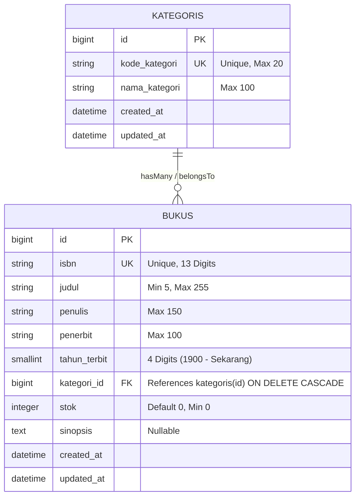

# Skema Database, Relasi Eloquent, Validasi, & Kontrak Rute
# SIPUS-Del — Sistem Informasi Perpustakaan Kampus Del

---

## 1. Diagram Relasi Entitas (Entity-Relationship Diagram)

Sistem database SIPUS-Del menggunakan mesin relasional **SQLite** dengan kardinalitas **One-to-Many (1:N)** antara entitas Kategori dan Buku. Satu kategori dapat menaungi banyak judul buku, dan setiap buku terikat pada tepat satu kategori induk.



---

## 2. Spesifikasi Kolom & Skema Migrasi (Database Migrations)

### 2.1 Tabel `kategoris`
Berkas migrasi: `database/migrations/2026_02_23_000001_create_kategoris_table.php`

```php
use Illuminate\Database\Migrations\Migration;
use Illuminate\Database\Schema\Blueprint;
use Illuminate\Support\Facades\Schema;

return new class extends Migration {
    public function up(): void {
        Schema::create('kategoris', function (Blueprint $table) {
            $table->id();
            $table->string('kode_kategori', 20)->unique()->comment('Kode unik klasifikasi, e.g. INF, SI, MAT');
            $table->string('nama_kategori', 100)->comment('Nama bidang ilmu perpustakaan');
            $table->timestamps();
        });
    }

    public function down(): void {
        Schema::dropIfExists('kategoris');
    }
};
```

### 2.2 Tabel `bukus`
Berkas migrasi: `database/migrations/2026_02_23_000002_create_bukus_table.php`

```php
use Illuminate\Database\Migrations\Migration;
use Illuminate\Database\Schema\Blueprint;
use Illuminate\Support\Facades\Schema;

return new class extends Migration {
    public function up(): void {
        Schema::create('bukus', function (Blueprint $table) {
            $table->id();
            $table->string('isbn', 13)->unique()->comment('Nomor unik ISBN 13 digit tanpa tanda hubung');
            $table->string('judul', 255)->comment('Judul lengkap buku');
            $table->string('penulis', 150)->comment('Nama penulis atau pengarang');
            $table->string('penerbit', 100)->comment('Nama instansi/perusahaan penerbit');
            $table->unsignedSmallInteger('tahun_terbit')->comment('Tahun publikasi cetak 4 digit');
            $table->foreignId('kategori_id')
                  ->constrained('kategoris')
                  ->cascadeOnDelete()
                  ->comment('Relasi foreign key ke tabel kategoris dengan cascade delete');
            $table->unsignedInteger('stok')->default(0)->comment('Jumlah sisa fisik eksemplar buku di rak');
            $table->text('sinopsis')->nullable()->comment('Ringkasan deskripsi konten buku');
            $table->timestamps();

            // Index tambahan untuk akselerasi kueri filter
            $table->index('kategori_id');
            $table->index('judul');
        });
    }

    public function down(): void {
        Schema::dropIfExists('bukus');
    }
};
```

---

## 3. Pemodelan Model Eloquent & Relasi Data

### 3.1 Model `App\Models\Kategori`
```php
namespace App\Models;

use Illuminate\Database\Eloquent\Factories\HasFactory;
use Illuminate\Database\Eloquent\Model;
use Illuminate\Database\Eloquent\Relations\HasMany;

class Kategori extends Model
{
    use HasFactory;

    /**
     * Atribut yang dapat diisi secara massal (Mass Assignment Protection).
     */
    protected $fillable = [
        'kode_kategori',
        'nama_kategori',
    ];

    /**
     * Relasi One-to-Many: Satu kategori memiliki banyak buku.
     */
    public function bukus(): HasMany
    {
        return $this->hasMany(Buku::class, 'kategori_id');
    }
}
```

### 3.2 Model `App\Models\Buku`
```php
namespace App\Models;

use Illuminate\Database\Eloquent\Factories\HasFactory;
use Illuminate\Database\Eloquent\Model;
use Illuminate\Database\Eloquent\Relations\BelongsTo;

class Buku extends Model
{
    use HasFactory;

    /**
     * Atribut yang dapat diisi secara massal (Mass Assignment Protection).
     */
    protected $fillable = [
        'isbn',
        'judul',
        'penulis',
        'penerbit',
        'tahun_terbit',
        'kategori_id',
        'stok',
        'sinopsis',
    ];

    /**
     * Relasi Many-to-One: Setiap buku dimiliki oleh tepat satu kategori.
     */
    public function kategori(): BelongsTo
    {
        return $this->belongsTo(Kategori::class, 'kategori_id');
    }
}
```

---

## 4. Optimasi Kueri & Mitigasi N+1 Problem

### 4.1 Bahaya Laten N+1 Query Problem
Jika kita memuat 10 data buku di halaman katalog dan memanggil relasi nama kategori secara Lazy Loading (`$buku->kategori->nama_kategori`) pada perulangan Blade, sistem akan mengeksekusi:
1. 1 kueri untuk mengambil 10 buku: `SELECT * FROM bukus LIMIT 10`
2. 10 kueri tambahan terpisah untuk setiap kategori buku: `SELECT * FROM kategoris WHERE id = ?`
Total: **11 kueri SQL** (atau 101 kueri untuk 100 data buku)!

### 4.2 Solusi Eager Loading Terpadu
Dengan menerapkan **Eager Loading** via metode `with('kategori')` pada Controller, Eloquent akan mengeksekusi tepat **2 kueri SQL** saja:
```php
// app/Http/Controllers/BukuController.php
public function index()
{
    $bukus = Buku::with('kategori')->latest()->paginate(10);
    return view('buku.index', compact('bukus'));
}
```
SQL yang dieksekusi:
1. `SELECT * FROM bukus ORDER BY created_at DESC LIMIT 10 OFFSET 0;`
2. `SELECT * FROM kategoris WHERE id IN (1, 2, 3, ...);`

### 4.3 Query Audit Listener di `AppServiceProvider`
Untuk membuktikan bahwa sistem berjalan efisien tanpa N+1 query, tambahkan listener pada `app/Providers/AppServiceProvider.php`:
```php
namespace App\Providers;

use Illuminate\Support\ServiceProvider;
use Illuminate\Support\Facades\DB;
use Illuminate\Support\Facades\Log;
use Illuminate\Pagination\Paginator;

class AppServiceProvider extends ServiceProvider
{
    public function boot(): void
    {
        // Paginator bergaya Bootstrap 5
        Paginator::useBootstrapFive();

        // Audit kueri SQL ke file storage/logs/laravel.log
        DB::listen(function ($query) {
            Log::info(sprintf(
                "[SQL AUDIT] (%.2f ms) %s", $query->time, $query->sql
            ));
        });
    }
}
```

---

## 5. Matriks Aturan Validasi Sisi Server (Server-Side Validation)

Seluruh validasi input diproses ketat pada Controller menggunakan `$request->validate()` sebelum data menyentuh database:

| Entitas | Kolom | Aturan Validasi (Store) | Aturan Validasi (Update) | Pesan Error Terkait |
| :--- | :--- | :--- | :--- | :--- |
| **Kategori** | `kode_kategori` | `required\|string\|max:20\|unique:kategoris,kode_kategori` | `required\|string\|max:20\|unique:kategoris,kode_kategori,{$id}` | Kode kategori wajib diisi, unik, dan maksimal 20 karakter. |
| **Kategori** | `nama_kategori` | `required\|string\|min:3\|max:100` | `required\|string\|min:3\|max:100` | Nama kategori wajib diisi minimal 3 dan maksimal 100 karakter. |
| **Buku** | `isbn` | `required\|digits:13\|unique:bukus,isbn` | `required\|digits:13\|unique:bukus,isbn,{$id}` | ISBN wajib 13 digit angka eksak dan tidak boleh terduplikasi. |
| **Buku** | `judul` | `required\|string\|min:5\|max:255` | `required\|string\|min:5\|max:255` | Judul buku minimal 5 karakter dan maksimal 255 karakter. |
| **Buku** | `penulis` | `required\|string\|max:150` | `required\|string\|max:150` | Nama penulis wajib diisi maksimal 150 karakter. |
| **Buku** | `penerbit` | `required\|string\|max:100` | `required\|string\|max:100` | Nama penerbit wajib diisi maksimal 100 karakter. |
| **Buku** | `tahun_terbit`| `required\|integer\|digits:4\|min:1900\|max:{current_year}` | `required\|integer\|digits:4\|min:1900\|max:{current_year}` | Tahun terbit wajib berupa 4 digit tahun yang valid (1900 s.d. sekarang). |
| **Buku** | `kategori_id` | `required\|exists:kategoris,id` | `required\|exists:kategoris,id` | Kategori wajib dipilih dan harus terdaftar di sistem. |
| **Buku** | `stok` | `required\|integer\|min:0` | `required\|integer\|min:0` | Jumlah stok wajib berupa angka non-negatif (minimal 0). |
| **Buku** | `sinopsis` | `nullable\|string` | `nullable\|string` | Sinopsis bersifat opsional berupa teks naratif. |

---

## 6. Kontrak Rute RESTful (Route Resource Contract)

Dua sumber daya utama didaftarkan melalui `routes/web.php` menggunakan `Route::resource()`:

```php
use App\Http\Controllers\KategoriController;
use App\Http\Controllers\BukuController;
use Illuminate\Support\Facades\Route;

// Redirect root ke katalog buku
Route::get('/', fn() => redirect()->route('buku.index'));

// 7 Aksi Baku Resource Kategori
Route::resource('kategori', KategoriController::class);

// 7 Aksi Baku Resource Buku
Route::resource('buku', BukuController::class);
```

### Tabel Rincian 7 Aksi Baku RESTful

| Method HTTP | URI Endpoint | Route Name | Action Method | Deskripsi Fungsi |
| :--- | :--- | :--- | :--- | :--- |
| `GET` | `/buku` | `buku.index` | `BukuController@index` | Menampilkan katalog semua buku (Eager Loading + Pagination). |
| `GET` | `/buku/create` | `buku.create` | `BukuController@create` | Menampilkan form pendaftaran buku baru (memuat list kategori). |
| `POST` | `/buku` | `buku.store` | `BukuController@store` | Menyimpan data buku baru ke database setelah lolos validasi. |
| `GET` | `/buku/{buku}` | `buku.show` | `BukuController@show` | Menampilkan kartu informasi detail bibliografi & sinopsis buku. |
| `GET` | `/buku/{buku}/edit` | `buku.edit` | `BukuController@edit` | Menampilkan form edit buku terisi data lama. |
| `PUT/PATCH` | `/buku/{buku}` | `buku.update` | `BukuController@update` | Memperbarui data buku pada database berlandaskan validasi. |
| `DELETE` | `/buku/{buku}` | `buku.destroy` | `BukuController@destroy` | Menghapus record buku dari database. |
| `GET` | `/kategori` | `kategori.index` | `KategoriController@index` | Menampilkan daftar kategori dan jumlah koleksi buku terkait. |
| `GET` | `/kategori/create` | `kategori.create`| `KategoriController@create`| Menampilkan form penambahan kategori baru. |
| `POST` | `/kategori` | `kategori.store` | `KategoriController@store` | Menyimpan kategori baru ke database. |
| `GET` | `/kategori/{kategori}/edit`| `kategori.edit` | `KategoriController@edit`| Menampilkan form edit data kategori. |
| `PUT/PATCH`| `/kategori/{kategori}`| `kategori.update` | `KategoriController@update`| Memperbarui record kategori. |
| `DELETE` | `/kategori/{kategori}`| `kategori.destroy`| `KategoriController@destroy`| Menghapus kategori beserta buku berelasi (*cascade*). |

