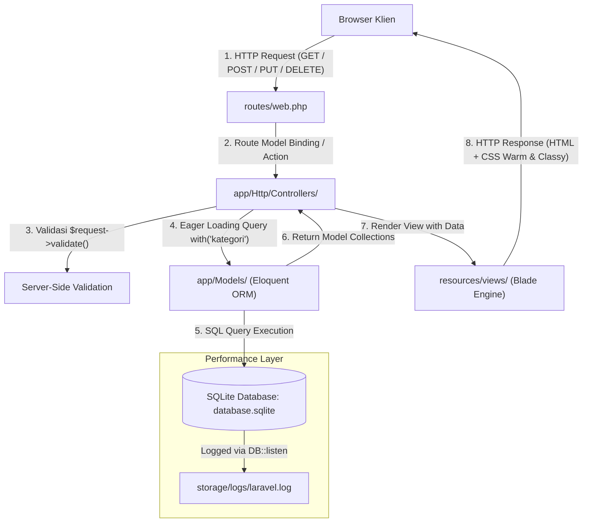

# Spesifikasi Arsitektur Teknologi & Struktur Proyek (Tech Stack)
# SIPUS-Del — Sistem Informasi Perpustakaan Kampus Del

---

## 1. Ikhtisar Arsitektur (Architectural Overview)

Aplikasi **SIPUS-Del** dibangun berlandaskan pola arsitektur **Model-View-Controller (MVC)** murni berbasis **Server-Side Rendering (SSR)** pada framework **Laravel 11.x**. Seluruh logika bisnis, orkestrasi alur HTTP, dan validasi data terisolasi di sisi server (*backend*), sedangkan presentasi visual dikelola secara modular oleh engine templating **Blade** (*frontend*) dengan panduan desain dari **Google Stitch**.



---

## 2. Breakdown Tumpukan Teknologi (Technology Stack)

### 2.1 Frontend Stack Layer

| Komponen | Teknologi / Versi | Peran & Deskripsi |
| :--- | :--- | :--- |
| **Design Prototype Engine** | **Google Stitch** | Generator prototipe visual awal berbasis AI yang menghasilkan struktur layout, sistem token warna warm & classy, dan file desain acuan (`stitch_design/`). |
| **Template Engine** | **Laravel Blade Component Engine** | Sistem templating deklaratif modular menggunakan `<x-layout>`, slot konten `{{ $slot }}`, direktif perulangan aman `@forelse ... @empty`, serta proteksi XSS otomatis `{{ ... }}`. |
| **CSS & UI Framework** | **Bootstrap 5.3 / Tailwind Utilities** | Framework CSS responsif untuk komponen layout, tabel data, grid system 12-kolom, modal konfirmasi, badge, dan alert notifikasi. |
| **Iconography** | **Material Symbols Outlined / Bootstrap Icons** | Pustaka ikon grafis vektor untuk tombol aksi (tambah, edit, hapus, detail, filter, buku, kategori). |
| **Typography** | **Google Fonts (Plus Jakarta Sans & JetBrains Mono)** | `Plus Jakarta Sans` untuk judul dan teks bacaan; `JetBrains Mono` untuk kode ISBN dan kode kategori. |
| **Asset Pipeline** | **Vite Bundler** | Bundler modern bawaan Laravel 11 untuk kompilasi aset frontend secara instan dan efisien. |

### 2.2 Backend Stack Layer

| Komponen | Teknologi / Versi | Peran & Deskripsi |
| :--- | :--- | :--- |
| **Programming Language** | **PHP 8.2 / 8.3 CLI** | Runtime bahasa pemrograman server-side dengan pengetikan deklaratif (`typed properties`, `match expressions`). |
| **Web Framework** | **Laravel 11.x** | Kerangka kerja PHP modern dengan struktur direktori ramping (*streamlined bootstrap* `bootstrap/app.php` tanpa boilerplate usang). |
| **Database Engine** | **SQLite 3** | Mesin database relasional lokal berbasis berkas (`database/database.sqlite`). Ringan, cepat, portabel, dan tidak memerlukan konfigurasi server database terpisah. |
| **ORM / Data Layer** | **Eloquent ORM** | Implementasi pola Active Record dengan proteksi Mass Assignment (`$fillable`), kardinalitas relasional (`hasMany`, `belongsTo`), dan kapabilitas optimasi kueri Eager Loading (`with()`). |
| **CLI & Scaffolding** | **Artisan CLI** | Generator perintah command-line untuk pembuatan migration, model, factory, seeder, dan controller. |
| **Mocking Library** | **FakerPHP** | Pustaka generator data dummy lokal untuk mengisi minimal 5 kategori dan 20 data buku realistis. |
| **Query Auditor** | **`DB::listen` Query Listener** | Listener kueri terintegrasi pada `AppServiceProvider` untuk mengaudit waktu eksekusi SQL dan mendeteksi/memitigasi potensi N+1 Query Problem. |

---

## 3. Pemisahan Struktur Direktori (Frontend vs Backend Separation)

Aplikasi `sim-del/` mengelompokkan berkas secara disiplin berlandaskan prinsip *Separation of Concerns (SoC)*:

```
sim-del/
├── app/                                 # [BACKEND] Core Application Logic
│   ├── Http/
│   │   └── Controllers/                 # RESTful Controllers (7 Aksi Baku)
│   │       ├── Controller.php           # Base Controller
│   │       ├── KategoriController.php   # Controller CRUD Kategori
│   │       └── BukuController.php       # Controller CRUD Buku (Eager Loading)
│   ├── Models/                          # Eloquent Active Record Models
│   │   ├── User.php                     # Default User Model
│   │   ├── Kategori.php                 # Model Kategori (relasi bukus())
│   │   └── Buku.php                     # Model Buku (relasi kategori())
│   └── Providers/
│       └── AppServiceProvider.php       # Pemasangan DB::listen & Paginator UI
│
├── bootstrap/
│   └── app.php                          # [BACKEND] Laravel 11 Streamlined App Bootstrapper
│
├── config/                              # [BACKEND] Configuration Repository
│   ├── database.php                     # Konfigurasi Koneksi SQLite
│   └── app.php
│
├── database/                            # [BACKEND] Database Layer & Migrations
│   ├── database.sqlite                  # Berkas Fisik Basis Data SQLite
│   ├── factories/                       # Blueprint Mock Data Faker
│   │   ├── KategoriFactory.php          # Factory Mock Data Kategori
│   │   └── BukuFactory.php              # Factory Mock Data Buku
│   ├── migrations/                      # Skema Tabel Berversi (Database Version Control)
│   │   ├── ..._create_kategoris_table.php # Skema Tabel kategoris
│   │   └── ..._create_bukus_table.php     # Skema Tabel bukus (FK kategori_id)
│   └── seeders/                         # Injeksi Data Awal
│       └── DatabaseSeeder.php           # Seeder 5 Kategori & 20 Buku
│
├── public/                              # [ASSETS] Web Server Document Root
│   ├── index.php                        # Titik Masuk Tunggal (Single Entry Point)
│   └── build/                           # Hasil Kompilasi Aset Vite
│
├── resources/                           # [FRONTEND] Presentation & View Layer
│   ├── css/                             # Styling Tambahan & Desain Token
│   │   └── app.css                      # CSS Variables Tema "Warm & Classy"
│   ├── js/
│   │   └── app.js                       # Script Bootstrapper Frontend
│   └── views/                           # Template Engine Blade
│       ├── components/                  # Blade Reusable Components
│       │   ├── layout.blade.php         # Master Shell Layout (<x-layout>)
│       │   ├── flash-alert.blade.php    # Komponen Notifikasi Flash Sukses/Galat
│       │   └── empty-state.blade.php    # Komponen Status Data Kosong
│       ├── kategori/                    # Tampilan CRUD Kategori
│       │   ├── index.blade.php          # Tabel Daftar Kategori & Aksi
│       │   ├── create.blade.php         # Form Tambah Kategori
│       │   └── edit.blade.php           # Form Edit Kategori
│       └── buku/                        # Tampilan CRUD Buku
│           ├── index.blade.php          # Katalog & Tabel Buku (+ Pagination & Filter)
│           ├── show.blade.php           # Detail Informasi Buku & Sinopsis
│           ├── create.blade.php         # Form Tambah Buku (+ Dropdown Kategori)
│           └── edit.blade.php           # Form Edit Buku (+ Binding Data Lama)
│
├── routes/                              # [BACKEND] HTTP Route Definitions
│   ├── console.php                      # Console Commands
│   └── web.php                          # Deklarasi Route::resource('kategori', ...) & Buku
│
├── storage/                             # [RUNTIME] Logs, Sessions, & File Cache
│   └── logs/
│       └── laravel.log                  # Target Pencatatan Audit SQL [SQL AUDIT]
│
├── .cursorrules                         # [GOVERNANCE] Instruksi AI Coding Assistant
├── prd.md                               # [PLANNING] Product Requirement Document
├── tech-stack.md                        # [PLANNING] Dokumen Spesifikasi Teknologi
├── design.md                            # [PLANNING] Design System "Warm & Classy"
├── schema.md                            # [PLANNING] Skema Database, Validasi & Routes
└── todo.md                              # [PLANNING] Milestone Task Backlog
```

---

## 4. Konfigurasi Lingkungan (Environment Requirements)

Berkas konfigurasi utama `.env` di dalam `sim-del/` diatur dengan nilai kunci:
```ini
APP_NAME="SIPUS-Del Perpustakaan"
APP_ENV=local
APP_DEBUG=true
APP_TIMEZONE=Asia/Jakarta
APP_URL=http://localhost:8000

DB_CONNECTION=sqlite
# Database SQLite otomatis diarahkan ke database/database.sqlite
```
Semua dependensi terinstalasi secara terisolasi tanpa memerlukan akses server eksternal ataupun registrasi layanan pihak ketiga.

